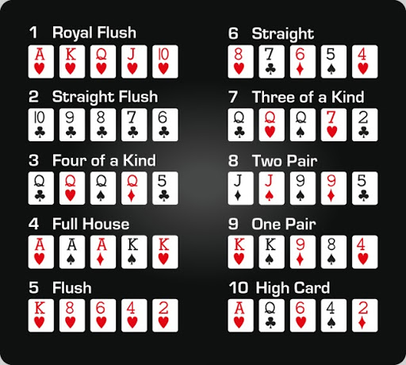

# Poker Hand Detection using YOLO



## Overview

This project showcases real-time poker hand detection using YOLO (You Only Look Once) object detection. Inspired by Murtaza's Workshop object detection tutorial, it identifies and labels playing cards in a webcam or video stream, allowing for the determination of poker hands.

The project is equipped to recognize various playing card ranks and suits, making it a fun and engaging application for card game enthusiasts and developers interested in computer vision.

## Requirements

- Python 3.9+
- Dependencies pinned in `requirements.txt`:

  ```bash
  pip install -r requirements.txt
  ```

- `pokerHandDetector/PokerHandFunction.py` (included) classifies a 5-card hand.
- YOLO weights `pokerHandDetector/playingCards.pt` (included).

## Usage

1. Clone the repository and enter the detector folder:

   ```bash
   git clone https://github.com/ysohaarsh/poker_hand_detection.git
   cd poker_hand_detection/pokerHandDetector
   ```

2. Run the detector (webcam by default):

   ```bash
   python Poker-Hand-Detector.py
   python Poker-Hand-Detector.py --source path/to/video.mp4 --conf 0.6
   ```

   Options: `--source` (webcam index or video file), `--model` (weights path, default
   `playingCards.pt`), `--conf` (minimum confidence, default 0.5). Press `q` to quit.

## Tests

```bash
pip install -r requirements-dev.txt
python -m pytest
```

## How it Works

- The YOLO model is used to detect and classify playing cards in real-time.

- Detected cards are labeled with their ranks and suits, and their positions are marked with corner rectangles.

- When exactly five distinct cards are detected above the confidence threshold, the hand is classified and shown on screen.

## Credits

This project is inspired by Murtaza's Workshop object detection tutorial, which provided the foundation for developing the poker hand detection system.

## License

This project is licensed under the MIT License - see the [LICENSE](LICENSE) file for details.
